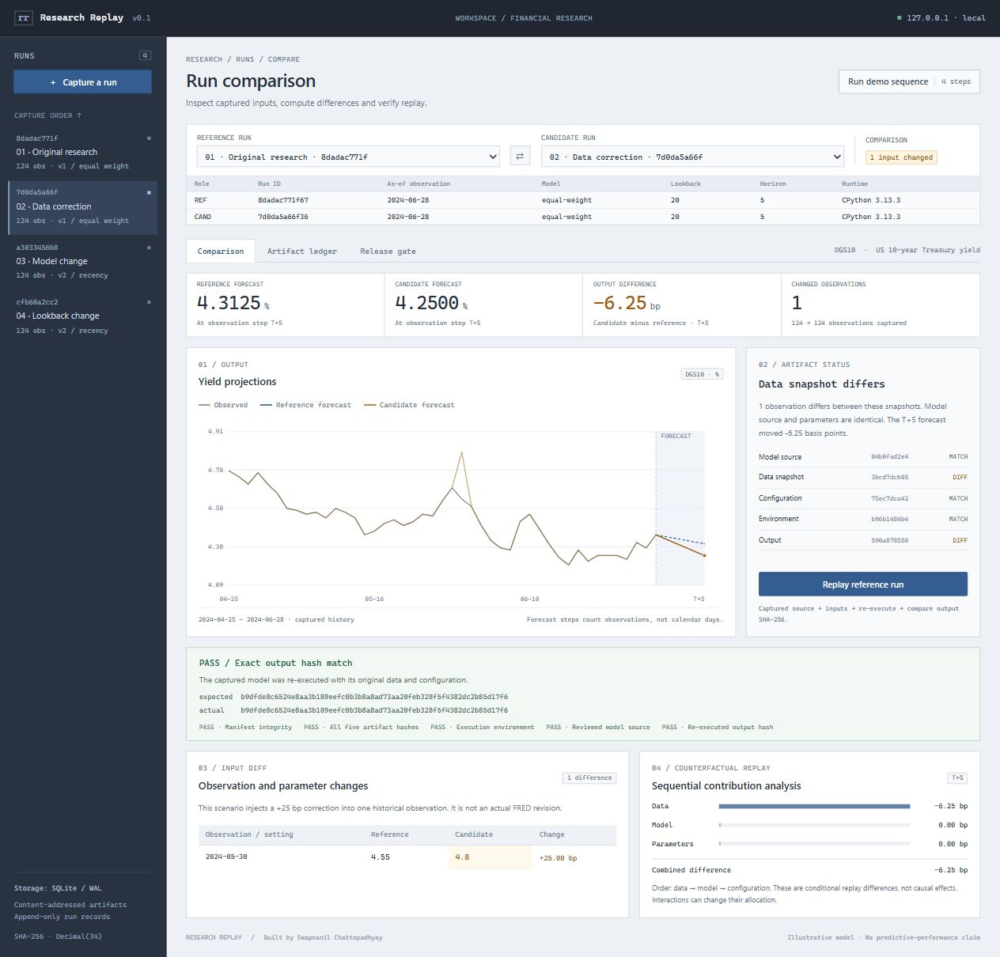
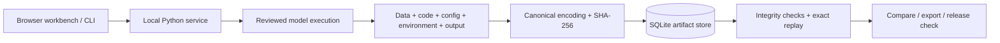

# Research Replay

**Capture, compare and replay financial research runs.**

A financial research workbench that captures a model's inputs and output together, investigates differences between runs, and re-executes earlier research from its original artifacts.

The demo changes **one historical Treasury-yield observation**, while leaving the model, parameters, and final observed yield untouched. The five-step forecast changes by **−6.25 basis points**. Replay recovers the original output exactly; the release gate rejects the changed candidate against the original approval.

Built by [Swapnanil Chattopadhyay](https://github.com/Swapnanil-06).



## Try it in under a minute

Requires **Python 3.11 or newer**. No packages, API keys, database server, JavaScript build step, or runtime internet access required.

```bash
git clone https://github.com/Swapnanil-06/time-travel-debugger-for-financial-research.git
cd time-travel-debugger-for-financial-research
python -m app.server
```

Open **http://127.0.0.1:8765** and select **Run demo sequence**. On Windows, `py` can be used in place of `python`; on some Unix systems, use `python3`.

Prefer a terminal? The complete investigation also runs without a browser and uses a disposable database:

```bash
python -m app.cli demo
```

```text
1. CAPTURE  124 real DGS10 observations; as-of 2024-06-28.
2. COMPARE  Injected correction on 2024-05-30: 4.55% -> 4.8%.
            Identical code and parameters; T+5 forecast difference: -6.25 bp.
3. REPLAY   Original output reproduced: [matching SHA-256 digest]
4. GATE     Corrected candidate BLOCKED (data, output).
            Identical approved candidate PASSED.
```

## Why this exists

Version-controlling a research script is only part of reproducing a result. The underlying data can be corrected, a parameter can change, or the execution environment can drift. An unchanged script can then produce a different answer.

This project was inspired by LMR Partners' public description of moving from exploratory research and agreed, version-controlled models to deterministic production outputs. It explores a narrow engineering question: **can the handover carry enough evidence to reproduce the result and explain subsequent differences?**

This is an independent project, with no affiliation to LMR and no access to its systems. The motivating workflow is described on [LMR's AI page](https://www.lmrpartners.com/ai).

## What you can investigate

| Capability | What actually happens |
| --- | --- |
| Capture | Executes a reviewed model and stores data, source, parameters, environment and output as SHA-256-addressed artifacts. |
| Compare | Shows exact observation and parameter differences, artifact fingerprints and forecast overlays. |
| Controlled replay | Substitutes data, model and parameters in a stated order to measure conditional changes at a common forecast step. |
| Replay | Validates the manifest and all artifact hashes, checks the execution context, re-executes the captured source, and compares the output hash. |
| Release gate | Records an approval against the reference manifest. A candidate must replay successfully and match all five approved artifact fingerprints. |
| Export | Downloads a self-contained JSON bundle with captured source, data, configuration, environment, output and checksums. |
| Import | Accepts a two-column CSV of yield observations and captures it as a new experiment. |

Four executed runs are created on first launch: the original research, an injected data correction, a model change, and a lookback change. The tour demonstrates the correction, exact replay, and a blocked release. To see a passing release, select the approved reference on both sides, or capture a new run with identical inputs.

## The financial example

The bundled data is **DGS10**, the daily US 10-year constant-maturity Treasury yield, from 2 January to 28 June 2024. Missing observations are omitted without interpolation. The original downloaded CSV, download URL, retrieval date and checksum are included in [`data/provenance.json`](data/provenance.json).

The deliberately simple model estimates drift from the latest `lookback` observed yield changes, then projects that drift for `horizon` observation steps:

```text
change[t] = yield[t] − yield[t−1]
drift     = mean(last lookback changes)
forecast[k] = final observed yield + k × drift
```

The second implementation weights more recent changes linearly. Both use an explicit 34-digit Decimal context and serialize decimal outputs as strings. A basis point is 0.01 percentage points of yield; the demo's injected correction is +0.25 percentage points, or +25 bp.

**Why does a correction to an older observation matter?** The equal-weight mean of changes telescopes to `(final yield − window-start yield) / lookback`. The injected correction changes the window-start observation, twenty observed steps before the final date. The drift therefore changes by `−25 / 20 = −1.25 bp` per step, and the five-step forecast by `−6.25 bp`. The final observed yield remains 4.36%.

The model is intentionally transparent so the expected result can be checked by hand. It is **not presented as a useful trading strategy, a validated forecast, or evidence of alpha**. Observation steps are not calendar days.

## Design



- **No hidden computation in the interface.** The server executes the model and comparisons. Browser numbers are presentation formatting of the captured Decimal outputs.
- **Content-addressed storage.** Identical artifacts deduplicate. A run manifest binds their digests to provenance and capture metadata.
- **Append-only records.** SQLite triggers reject updates and deletes of runs and artifact blobs. The application exposes no mutation endpoint for them.
- **Source snapshots, not just names.** The exact bundled model source is captured. Execution accepts only the currently reviewed implementations; uploaded Python is never executed.
- **Strict replay.** The Python patch version, implementation, operating-system family, Decimal policy and execution-engine source fingerprint must match. Different run labels and capture timestamps do not affect computational identity.
- **Honest comparison.** The data → model → configuration decomposition is ordered and conditional. Effects can interact, and changing the order can change the allocated contributions. If an intermediate combination is invalid, the interface explains that instead of inventing a contribution.

The implementation has no third-party runtime dependencies: Python's HTTP server, `sqlite3`, `decimal`, `hashlib`, a plain JavaScript interface and an SVG chart. See [architecture and trade-offs](docs/architecture.md) for the storage contract, trust boundaries and deliberate limits.

## Export and replay outside the database

Use **Artifact ledger → Export candidate bundle**, or:

```bash
python -m app.cli list
python -m app.cli replay RUN_ID
python -m app.cli export RUN_ID captured-run.json
python -m app.cli verify captured-run.json
```

Verification does not need the original SQLite database. It does need this project's reviewed model implementations and the recorded execution environment. Checksums verify consistency, not who authored a bundle or whether its financial assumptions are sound.

## Import your own observations

Choose **Capture a run → Import my own CSV**. The format is intentionally constrained:

```csv
date,value
2024-01-02,3.95
2024-01-03,3.91
2024-01-04,3.99
2024-01-05,4.05
```

Dates must be unique and increasing. Values are yields in percent, finite, within −100 to +100, with at most twelve decimal places. Use at least `lookback + 1` observations; the minimum lookback is two. The UI also accepts the original FRED `observation_date,DGS10` headers and skips empty or `.` observations. A file's source or historical publication schedule is not independently verified.

## Validation

```bash
python -m unittest discover -v
node --check static/app.js
```

The standard-library tests cover hand-checkable model outputs, data provenance, deterministic replay, changed data/code/configuration, ordered comparisons, blocked and passing releases, exported-bundle tampering, immutable records, corruption detection, environment mismatches, arbitrary-source rejection, input validation, and HTTP integration. Node is only needed for the optional JavaScript syntax check, not to run the app.

GitHub Actions runs the Python suite on Linux and Windows with Python 3.11 and 3.13.

## Scope and limitations

- The correction is **injected for demonstration**, not an actual FRED revision. The snapshot was downloaded on 8 November 2026 and is not a point-in-time 2024 vintage. The project does not claim a look-ahead-free historical backtest.
- Hash checks and SQLite triggers detect accidental alteration within this workflow. They are not an externally signed audit trail and do not protect against an administrator who can rewrite the database and its checksums.
- Approval is a local recorded decision, with no authenticated approver identity. The release gate verifies artifacts; it does not deploy a job or connect to a scheduler.
- Runs are intentionally limited to two bundled model implementations. Containerized historical runtimes and arbitrary research packages are outside this version's scope.
- The server binds to loopback, rejects unexpected Host headers and cross-origin browser writes, and uses a restrictive content security policy. It is a **local single-user workbench**, not an internet-facing production service.

Application state lives under ignored `.replay/`. Stop with `Ctrl+C`. To use a separate workspace without touching existing runs:

```bash
python -m app.server --port 8766 --db .replay/another-workspace.sqlite3
```

## Data attribution

Board of Governors of the Federal Reserve System (US), *Market Yield on U.S. Treasury Securities at 10-Year Constant Maturity, Quoted on an Investment Basis* [DGS10], retrieved from [FRED, Federal Reserve Bank of St. Louis](https://fred.stlouisfed.org/series/DGS10). Original data remains subject to its source's terms; attribution and retrieval metadata are retained with each seeded run.
